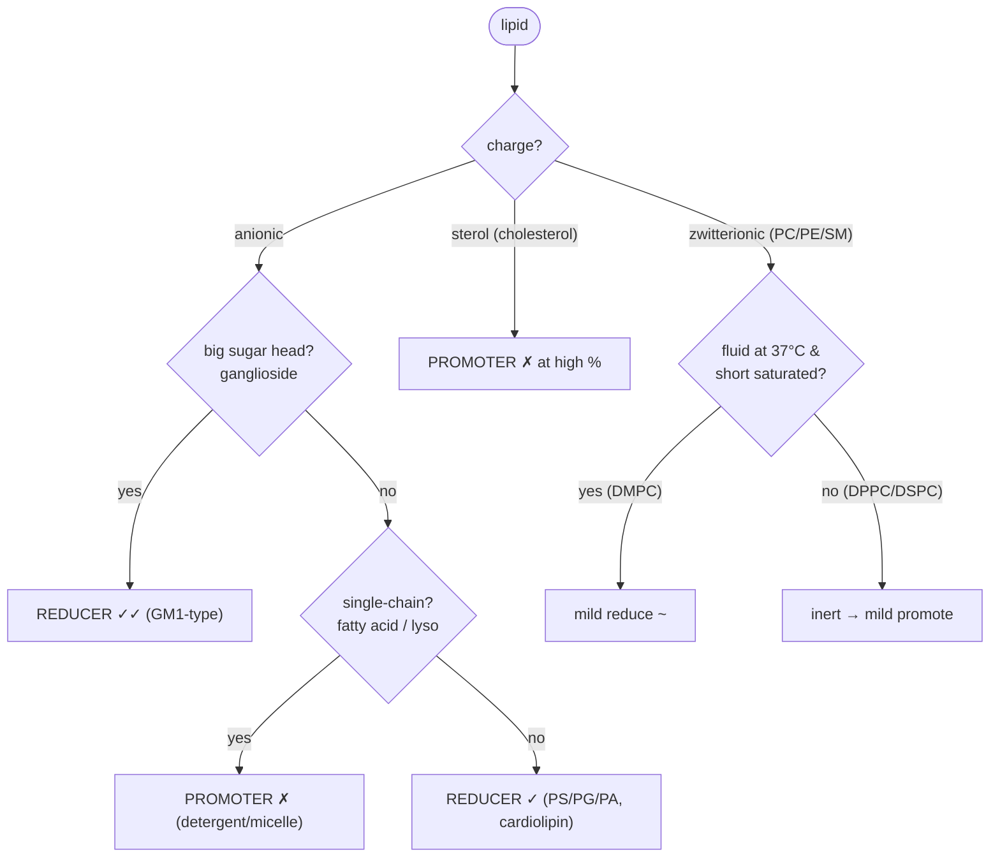

# How the model scores a lipid — 1-page summary

**Goal:** predict whether a lipid **reduces** α-synuclein fibrils, to prioritise experiments.
Built as a rule-based *prior from ~10 papers*, pinned to **Yuval's assay** (A53T, pH 7.4, high
lipid:protein). It's a starting guess — **your ThT data will re-fit it.**

## The decision tree

## In words
- **Anionic lipids** (PS, PG, PA, gangliosides) → bind α-syn → at Yuval's high ratio + neutral pH
  they **sequester it → reduce fibrils.** Gangliosides strongest.
- **Zwitterionic PC/PE and sphingomyelin** → weak binders → mostly **inert**; a fluid short one
  (DMPC) can mildly help, gel ones (DPPC/DSPC) don't.
- **Cholesterol** → **promotes** at high % (raises membrane hydrophobicity).
- **Free fatty acids / single-chain** → detergent-like → **promote**.

## 4 things that are fixed by Yuval's setup (and flip the answer)
1. **pH 7.4** → pushes binders toward *inhibition* (acidic pH would do the opposite).
2. **High ratio (10:1, 50:1)** → *sequestration* regime → favours reduction.
3. **Ethanol vehicle** → *itself speeds aggregation* → compare each lipid to its **same-% control**;
   don't compare 10:1 vs 50:1.
4. **A53T** → binds membranes *more* than WT → effects likely stronger.

## Where each rule comes from (paper → takeaway)
| rule | source | takeaway |
|---|---|---|
| charge gate | Galvagnion 2016; Gaspar 2018 | α-syn binds anionic, not pure PC |
| gangliosides strongest | Grey 2015; Gaspar 2018; Martinez 2007 | big sugar head = biggest effect |
| **pH flips sign** | Martinez 2007 (neutral=inhibit) vs Gaspar/Grey (acidic=accelerate) | GM1 inhibits at pH 7.4 |
| high ratio → reduce | Galvagnion 2015 | excess lipid stops/ dissolves fibrils |
| cholesterol promotes; DMPC suppresses, DPPC doesn't | Matveyenka 2024; Dou 2023 | 14:0→16:0 flips a PC |
| fatty acids promote | JBC 2003 | anionic micelles accelerate |
| ethanol not inert | Chem Sci 2021 | alcohol speeds aggregation at 100 µM/pH 7 |
| A53T binds more | Jo 2000 | effects amplified vs WT |

*Full version with quotes & DOIs: `DOC1_lipid_decision_tree.md`.*
